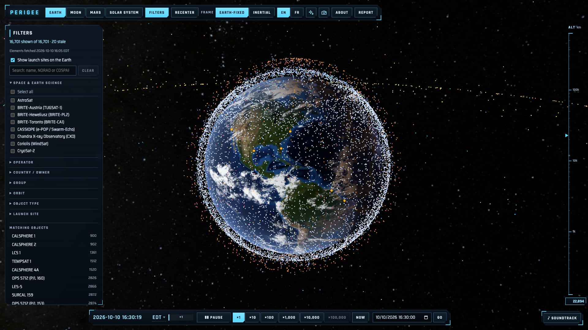
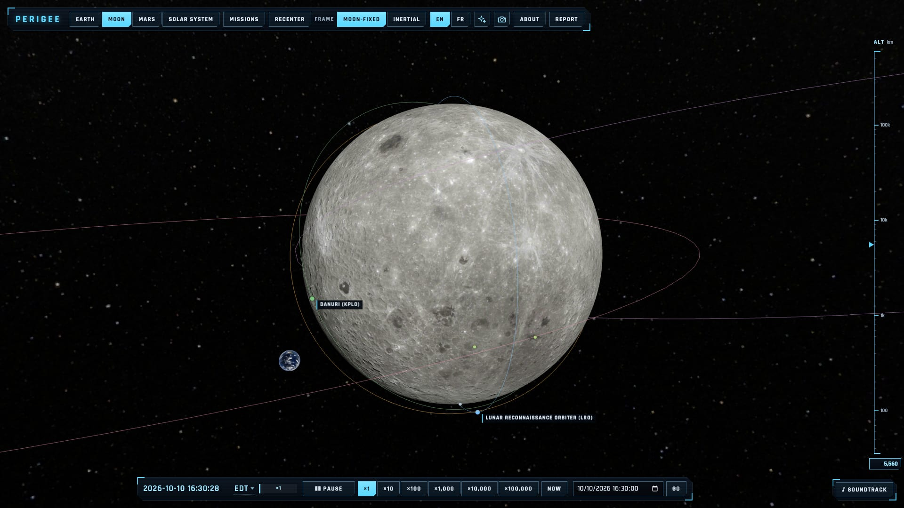
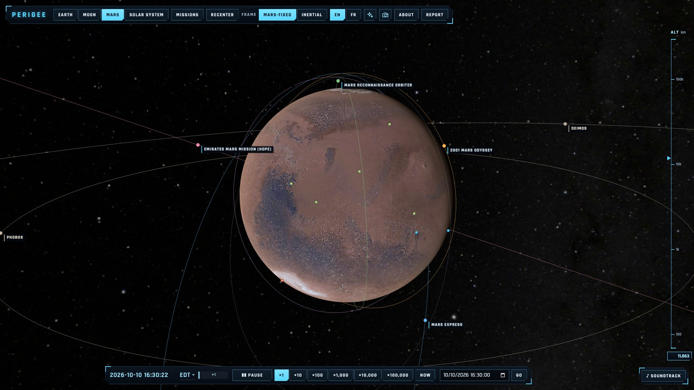
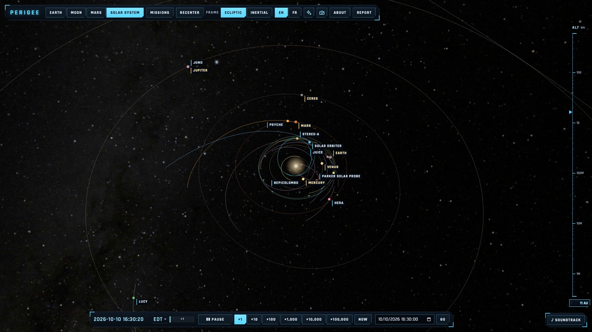
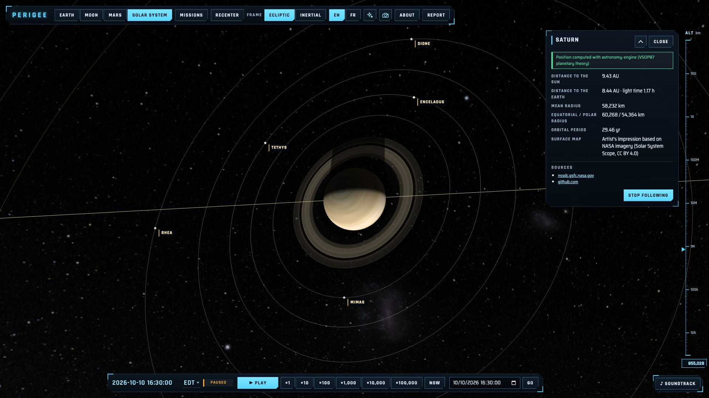
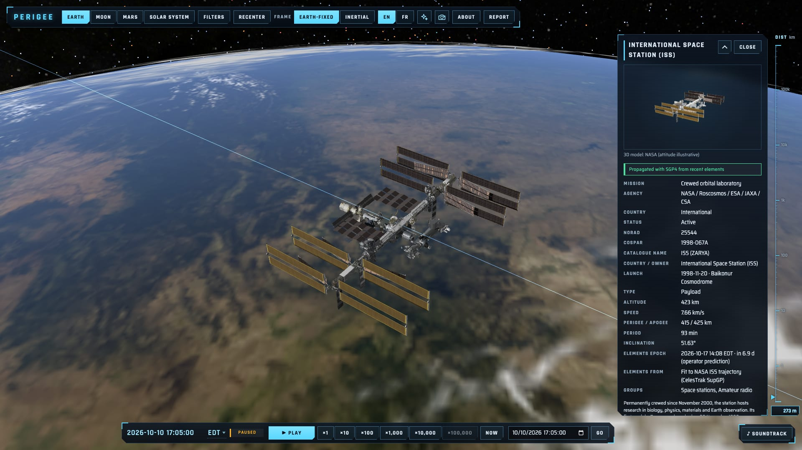
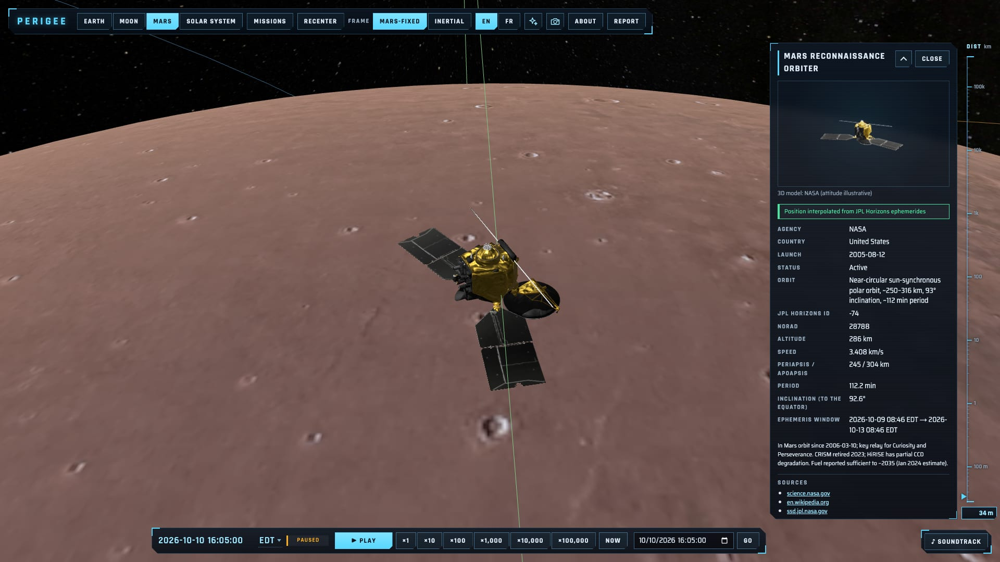
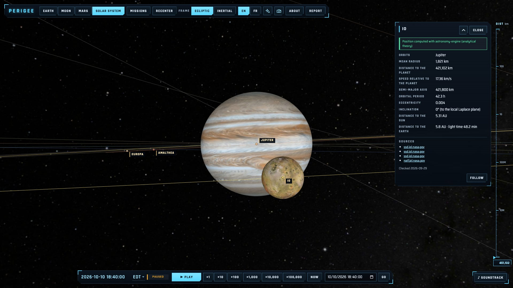

# Perigee

**Perigee** shows, in real time, the artificial objects orbiting the Earth, the Moon and Mars, and the
spacecraft travelling through the solar system. Every position is computed in your browser from public data
(CelesTrak, NASA/JPL Horizons, astronomy-engine). The site works in English and French (_Périgée_) and keeps
working offline once visited.

**→ [Open Perigee](https://perigee.info/)**

> Educational use only — not intended for navigation or conjunction assessment.

## What you can see

| View             | Contents                                                                                                                                                                                                    |
| ---------------- | ----------------------------------------------------------------------------------------------------------------------------------------------------------------------------------------------------------- |
| **Earth**        | Every active catalogued satellite (~16,000), propagated with SGP4 from CelesTrak elements refreshed every 4 hours, and 30 orbital launch sites.                                                             |
| **Moon**         | Active lunar orbiters from JPL Horizons ephemerides, the Earth at its true position, and 50+ landing and impact sites.                                                                                      |
| **Mars**         | Mars orbiters, Phobos and Deimos, landing sites and the latest positions of the Curiosity and Perseverance rovers.                                                                                          |
| **Solar system** | The Sun, the planets, five dwarf planets, 28 of their moons (shown when you come close) and 20+ interplanetary spacecraft, with distances and light travel time. An optional logarithmic scale fits it all. |

<table>
  <tr>
    <td width="50%"></td>
    <td width="50%"></td>
  </tr>
  <tr>
    <td><b>Moon</b>: lunar orbiters, with the Earth at its true place.</td>
    <td><b>Mars</b>: orbiters, Phobos and Deimos.</td>
  </tr>
  <tr>
    <td></td>
    <td></td>
  </tr>
  <tr>
    <td><b>Solar system</b>: planets and the trajectories of interplanetary spacecraft.</td>
    <td><b>Saturn</b> and its moons, followed from the day side.</td>
  </tr>
  <tr>
    <td></td>
    <td></td>
  </tr>
  <tr>
    <td>The <b>ISS</b> followed 400 km above the Earth, lit by the Sun.</td>
    <td><b>Mars Reconnaissance Orbiter</b> 300 km above Mars.</td>
  </tr>
  <tr>
    <td colspan="2"></td>
  </tr>
  <tr>
    <td colspan="2"><b>Io</b> passing in front of Jupiter and its Great Red Spot.</td>
  </tr>
</table>

Click any object to open its panel: identifiers (NORAD, COSPAR, Horizons), operator, country, launch date,
status, orbit, and where its position comes from. Positions that are **extrapolated** beyond their data, or
based on **stale** elements, are drawn dimmed or dashed and flagged in the panel.

### Up close

- **3D models**: the ISS, Hubble, the Mars rovers and some 30 other spacecraft (NASA 3D Resources) replace their
  marker when you come close; follow one and the camera comes to a few times its size. Their attitude is
  illustrative.
- **Bodies**: NASA and USGS maps of the planets and their moons, the giants and a few small bodies drawn with
  their real flattening, irregular moons from their shape models, Saturn's, Uranus' and Neptune's rings. The
  Sun can be selected too: its main figures, its rotation and the day's active regions.
- **Immersive effects** (high quality only, each switchable): relief from elevation models (Moon, Mars, Mercury,
  Ceres), illustrative Earth clouds with their shadows, gas moving with the winds of Venus and the giant planets,
  sunspots at the places NOAA reported them, and spacecraft lit by the Sun alone, with their own shadows and the
  shadow of the body they orbit.
- **Honest pictures**: artists' impressions, hand-drawn maps and illustrative effects are labelled as such in
  the panels.

## Using it

- **Rotate**: left-drag, or the arrow keys. **Roll**: right-drag, two-finger twist, or Q/E.
- **Zoom**: mouse wheel, pinch, or +/−. **Reset**: R or the _Recenter_ button.
- **Select**: click an object, or pick it in the side panel list. **Follow**: double-click it, or press F.
- **Time**: pause, run at ×1 to ×100,000 (×10,000 in the Earth view), go back to _Now_, or jump to any date.
- **Frame**: body-fixed (the body stays still) or inertial (the body turns, orbits stay fixed).
- **Filters** (Earth view): operator, country, constellation group, orbit (LEO, MEO, GEO, HEO), object type,
  launch site, plus text search by name, NORAD number or COSPAR ID.
- **Install**: your browser can install Perigee as an app; after a first visit it opens offline with the data
  it last downloaded (a badge tells you when you are offline).
- **Time zone**: dates and times are shown in your computer's time zone; click the zone name in the time bar
  to pick UTC or any other zone.
- **Quality and effects**: the site picks a rendering quality for your device (High, Medium or Saver) and adapts
  its resolution as it runs. The sparkle button in the top bar (_Quality & effects_ in the phone menu) lets you
  choose another quality and, at High, switch each immersive effect on or off.
- **Photo**: the camera button downloads the 3D view as two PNG images, one as shown (labels included, without
  the panels) and one with the objects only, titled with the followed object and the date.
- **Updates**: a tab left open learns about new data and new versions of the site within 15 minutes and offers
  to refresh (or refreshes by itself when you come back to it), keeping your view, selection and camera.

### Sharing a view

The address bar always describes what you see, so a link reproduces it:

| Parameter                                      | Meaning                                                                                                               |
| ---------------------------------------------- | --------------------------------------------------------------------------------------------------------------------- |
| `view=earth\|moon\|mars\|solar`                | View                                                                                                                  |
| `lang=en\|fr`                                  | Language                                                                                                              |
| `frame=fixed\|inertial`                        | Reference frame                                                                                                       |
| `t=<ISO 8601 UTC>`, `rate=<n>`                 | Simulated time and speed (absent: live)                                                                               |
| `sel=<id>`                                     | Selected object: NORAD number (Earth), mission or planet id, `sun`, `site:<id>` for a site, or `moon:<id>` for a moon |
| `q`, `op`, `own`, `grp`, `reg`, `type`, `site` | Earth-view search and filters (comma-separated values)                                                                |
| `ls=0`, `sites=0`                              | Hide launch sites (Earth) or landing sites (Moon, Mars)                                                               |
| `log=1`                                        | Logarithmic distances in the solar-system view                                                                        |
| `hide=<id>,<id>`                               | Missions not drawn in the Moon, Mars and solar-system views (unticked in the panel)                                   |
| `quality=high\|medium\|low`                    | Rendering quality (absent: chosen for the device)                                                                     |

## Data and credits

Satellite elements come from [CelesTrak](https://celestrak.org) (T.S. Kelso); spacecraft ephemerides from
[NASA/JPL Horizons](https://ssd.jpl.nasa.gov/horizons/); planet positions from
[astronomy-engine](https://github.com/cosinekitty/astronomy); solar active regions from
[NOAA SWPC](https://www.swpc.noaa.gov/); imagery and 3D models from NASA and USGS, plus a few planet maps by
[Solar System Scope](https://www.solarsystemscope.com/textures/) (CC BY 4.0). A GitHub Actions
pipeline mirrors the data (your browser never contacts these providers), and every mission, site and status is
curated with its sources in [`catalog/`](catalog/). Full list: [DATA_SOURCES.md](DATA_SOURCES.md).

Created by David Fugère-Lamarre. Code under the [MIT license](LICENSE).

## Contributing

Corrections to missions, statuses and sites are especially welcome: use the _Report_ button on the site, or open
an issue. See [CONTRIBUTING.md](CONTRIBUTING.md) for
the development setup (`npm install`, `npm run data:pull`, `npm run dev`) and the project rules.
