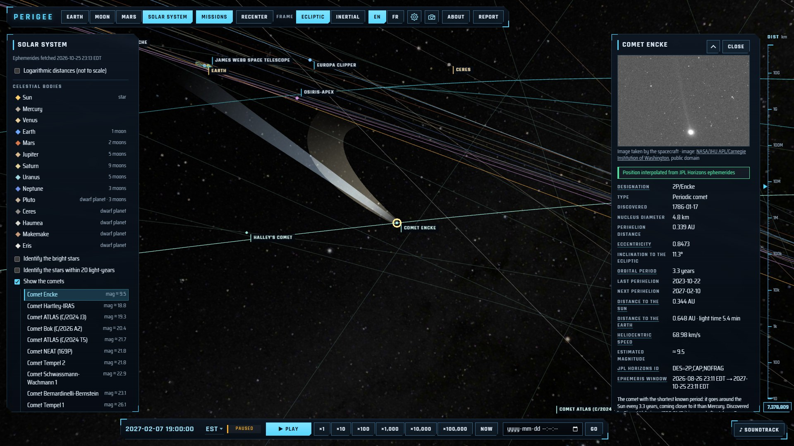
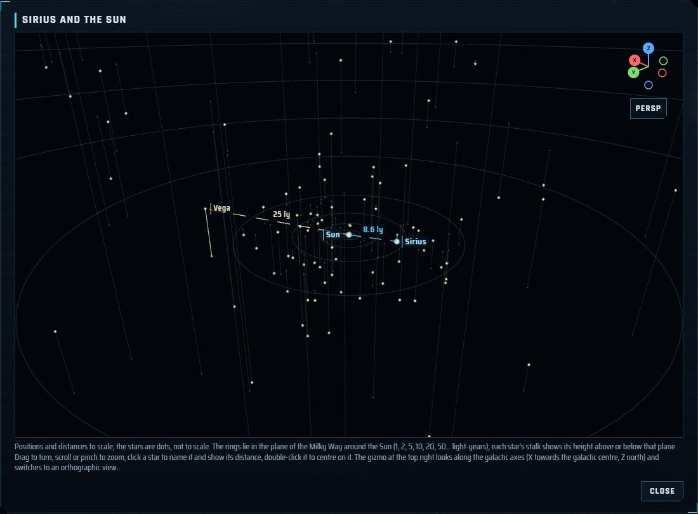
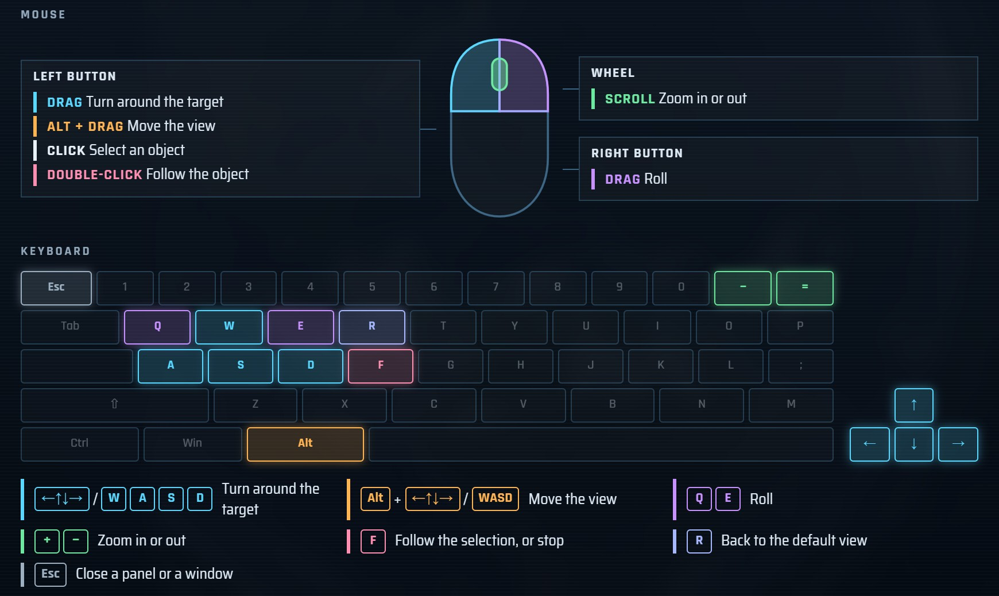
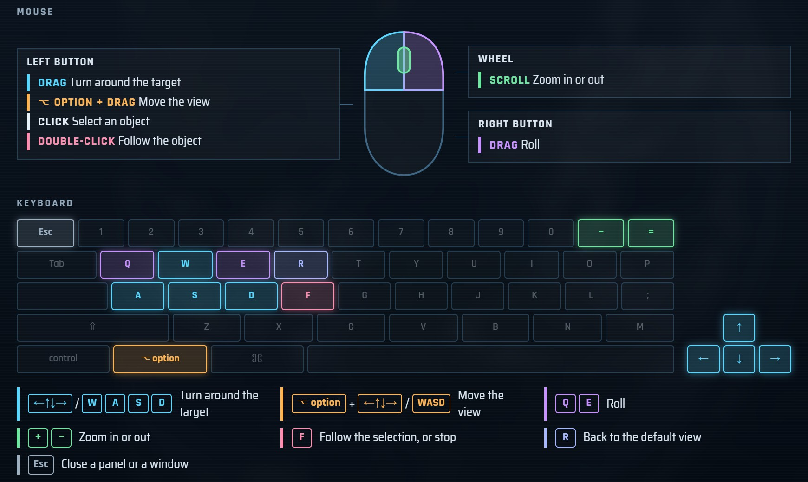
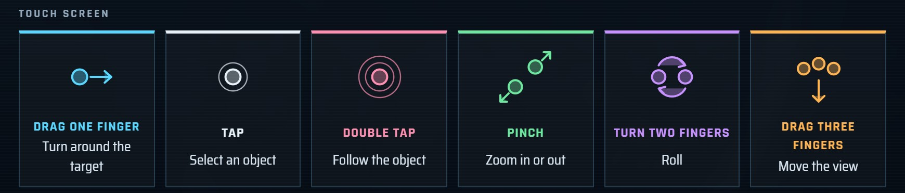

# Perigee

  
  
  
  
  

**Perigee** shows, in real time, the artificial objects orbiting the Earth, the Moon and Mars, and the
spacecraft travelling through the solar system. Every position is computed in your browser from public data
(CelesTrak, NASA/JPL Horizons, astronomy-engine). The site works in English and French (_Périgée_) and keeps
working offline once visited.

**→ [Open Perigee](https://perigee.info/)**

> Educational use only — not intended for navigation or conjunction assessment.

## What you can see

| View             | Contents                                                                                                                                                                                                                                                             |
| ---------------- | -------------------------------------------------------------------------------------------------------------------------------------------------------------------------------------------------------------------------------------------------------------------- |
| **Earth**        | Every active catalogued satellite (~16,000), propagated with SGP4 from CelesTrak elements refreshed every 4 hours, and 30 orbital launch sites.                                                                                                                      |
| **Moon**         | Active lunar orbiters from JPL Horizons ephemerides, the Earth at its true position, and 50+ landing and impact sites.                                                                                                                                               |
| **Mars**         | Mars orbiters, Phobos and Deimos, landing sites and the latest positions of the Curiosity and Perseverance rovers.                                                                                                                                                   |
| **Solar system** | The Sun, the planets, five dwarf planets, 28 of their moons (shown when you come close), 20+ interplanetary spacecraft and famous retired ones, 20 comets and 30 notable asteroids, with distances and light travel time. An optional logarithmic scale fits it all. |

<table>
  <tr>
    <td width="50%"></td>
    <td width="50%"></td>
  </tr>
  <tr>
    <td><b>Moon</b>: lunar orbiters, with the Earth at its true place.</td>
    <td><b>Mars</b>: orbiters, Phobos and Deimos.</td>
  </tr>
  <tr>
    <td></td>
    <td></td>
  </tr>
  <tr>
    <td><b>Solar system</b>: planets and the trajectories of interplanetary spacecraft.</td>
    <td><b>Saturn</b> and its moons, followed from the day side.</td>
  </tr>
  <tr>
    <td></td>
    <td></td>
  </tr>
  <tr>
    <td>The <b>ISS</b> followed 400 km above the Earth, lit by the Sun.</td>
    <td><b>Mars Reconnaissance Orbiter</b> 300 km above Mars.</td>
  </tr>
  <tr>
    <td colspan="2"></td>
  </tr>
  <tr>
    <td colspan="2"><b>Io</b> passing in front of Jupiter and its Great Red Spot.</td>
  </tr>
  <tr>
    <td colspan="2"></td>
  </tr>
  <tr>
    <td colspan="2"><b>Comet Encke</b> near perihelion, with its tails (illustrative) and the list of comets.</td>
  </tr>
</table>

Click any object to open its panel: identifiers (NORAD, COSPAR, Horizons), operator, country, launch date,
status, orbit, and where its position comes from. Probes, orbiters and science satellites also say what their
mission is for, in a short paragraph for students, and link their mission's own page first. Underlined field
names (spectral type, eccentricity, ephemeris window…) open a short definition. Positions that are **extrapolated** beyond their data, or
based on **stale** elements, are drawn dimmed or dashed and flagged in the panel.

### Up close

- **3D models**: the ISS, Hubble, the Mars rovers, some 45 other spacecraft and four asteroids (NASA 3D Resources) replace their
  marker when you come close; follow one and the camera comes to a few times its size. Their attitude is
  illustrative.
- **Pictures**: some 180 probes, comets, asteroids, landing sites, launch sites and science satellites without a 3D model
  show a photo, a view from orbit or an artist's impression (Wikimedia Commons, NASA, ESA, LROC), each with its
  author and licence; click it to see it larger.
- **Bodies**: NASA and USGS maps of the planets and their moons, the giants and a few small bodies drawn with
  their real flattening, irregular moons from their shape models, Saturn's, Uranus' and Neptune's rings. The
  Sun can be selected too: its main figures, its rotation and the day's active regions. Titan can be seen in
  visible light or in the near infrared, Venus by its cloud tops or its radar-mapped surface: a switch under the
  preview cross-fades between the two maps.
- **Landing and impact sites** on the Moon and Mars, and on Mercury, Venus and Titan in the solar-system view:
  tick the box in a body's panel to mark them on its surface and list them, then pick one for its own tab, with
  its date, mission and a picture, while the camera stays on the body.
- **Immersive effects** (high quality only, each switchable): relief from elevation models (Moon, Mars, Mercury,
  Ceres), illustrative Earth clouds with their shadows, gas moving with the winds of Venus and the giant planets,
  sunspots at the places NOAA reported them, and spacecraft lit by the Sun alone, with their own shadows and the
  shadow of the body they orbit.
- **Comets**: tick _Show the comets_ for 20 comets, famous ones (Halley, 67P, Hale-Bopp, Tsuchinshan-ATLAS…) and
  the current telescope targets, listed by estimated brightness. Each is placed from JPL Horizons, with its orbit
  (open orbits too) and illustrative ion and dust tails; its panel gives its perihelion, period, distances,
  estimated magnitude and, for 15 of them, a photo.
- **Asteroids**: tick _Show the notable asteroids_ for the largest ones (Vesta, Pallas, Hygiea…; Ceres is listed
  with the dwarf planets) and those visited by spacecraft (Eros, Itokawa, Ryugu, Bennu, Didymos, Dinkinesh…), listed
  by size and placed from JPL Horizons. Their panel gives size, rotation, moons, the missions that visited them and
  their orbit; Vesta, Bennu, Eros and Itokawa come with a NASA shape model, most others with a picture.
- **Retired spacecraft**: below the active probes, an _Inactive spacecraft_ section lists famous ended missions
  (Pioneer 10 and 11, Ulysses, Spitzer, Kepler, Planck, Herschel, Gaia, Galileo, Cassini, Rosetta, Dawn…). Those
  JPL Horizons still follows are drawn on their predicted path; the others are listed with their story. They are
  hidden by default: tick them one by one or with _Show all_, or select one to draw it.
- **Named stars**: tick _Identify the bright stars_ to label the 93 brightest stars on the starry background, or
  _Identify the stars within 20 light-years_ for the Sun's 57 nearest neighbours (a thin line points at each
  one); click a name for its distance, type, size, temperature and luminosity, with an illustration of the star
  beside the Sun at the same scale.
- **Star map**: click a star's illustration for a 3D map of it and the Sun, every named star at its real
  distance. Rings in the plane of the Milky Way and a stalk from each star to that plane show where they lie;
  click another star to compare its distance, and turn the map or look along the galactic axes, in perspective
  or orthographic view.

  

- **Previews**: the info panel shows the selected planet, moon or dwarf planet in 3D, as drawn in the view; in
  the Earth view the Moon can be selected too, with its phase.
- **Honest pictures**: artists' impressions, hand-drawn maps and illustrative effects are labelled as such in
  the panels.

## Using it

- **Rotate**: left-drag, one finger, the arrow keys or WASD. **Roll**: right-drag, a two-finger twist, or Q/E.
  Letter keys work by position: on an AZERTY keyboard they are ZQSD and A/E, and the settings window shows them so.
- **Zoom**: mouse wheel, pinch, or +/−. **Reset**: R or the _Recenter_ button.
- **Move the view**: Alt-drag (Option-drag on a Mac), Alt + arrows or WASD, or drag three fingers; you then turn and zoom
  around the new point. The camera stays inside a cube around the view, whose faces light up as a grid when you
  come near them.
- **Select**: click an object, or pick it in the side panel list. **Follow**: double-click it, or press F.
- **Time**: pause, run at ×1 to ×100,000 (×10,000 in the Earth view), go back to _Now_, or jump to any date.
  Up to 30 days back, satellites use the elements CelesTrak published then, and spacecraft the JPL Horizons
  ephemerides archived each day.
- **Frame**: body-fixed (the body stays still) or inertial (the body turns, orbits stay fixed).
- **Filters** (Earth view): operator, country, constellation group, orbit (LEO, MEO, GEO, HEO), object type,
  launch site, plus text search by name, NORAD number or COSPAR ID.
- **Install**: your browser can install Perigee as an app; after a first visit it opens offline with the data
  it last downloaded (a badge tells you when you are offline).
- **Time zone**: dates and times are shown in your computer's time zone; click the zone name in the time bar
  to pick UTC or any other zone.
- **Favorites**: the star button in the top bar (_Favorites_ in the phone menu) opens a list of views to jump
  to: four examples in real time (the ISS, Apollo 11's landing site, Mars Reconnaissance Orbiter and Voyager 1,
  followed), then the views you saved with _Add the current view_ (view, date, selection, filters, following).
  Picking one switches to its view and date and glides to the object. Up to 50 saved favorites stay in your
  browser (a web page cannot write to the browser's own bookmarks); delete one, or clear them all, after a
  confirmation.
- **Settings**: the site picks a rendering quality for your device (High, Medium or Saver) and adapts its
  resolution as it runs. The gear button in the top bar (_Settings_ in the phone menu) lets you choose another
  quality, switch each immersive effect on or off at High, and shows every control, drawn for your device.
- **Photo**: the camera button downloads the 3D view as two PNG images, one as shown (labels included, without
  the panels) and one with the objects only, titled with the followed object and the date.
- **Updates**: a tab left open learns about new data and new versions of the site within 15 minutes and offers
  to refresh (or refreshes by itself when you come back to it), keeping your view, selection and camera.

### Controls

The settings window draws the controls for the device you use: a mouse and a keyboard with Alt on Windows and
Linux, Option on a Mac, or the touch gestures on a phone or a tablet.

<table>
  <tr>
    <td width="50%"></td>
    <td width="50%"></td>
  </tr>
  <tr>
    <td><b>Windows and Linux</b>: mouse and keyboard, with Alt.</td>
    <td><b>macOS</b>: the same, with Option.</td>
  </tr>
  <tr>
    <td colspan="2"></td>
  </tr>
  <tr>
    <td colspan="2"><b>Touch screens</b>: one finger turns, two fingers zoom and roll, three fingers move the view.</td>
  </tr>
</table>

### Sharing a view

The address bar always describes what you see, so a link reproduces it:

| Parameter                                      | Meaning                                                                                                                                                                                                            |
| ---------------------------------------------- | ------------------------------------------------------------------------------------------------------------------------------------------------------------------------------------------------------------------ |
| `view=earth\|moon\|mars\|solar`                | View                                                                                                                                                                                                               |
| `lang=en\|fr`                                  | Language                                                                                                                                                                                                           |
| `frame=fixed\|inertial`                        | Reference frame                                                                                                                                                                                                    |
| `t=<ISO 8601 UTC>`, `rate=<n>`                 | Simulated time and speed (absent: live)                                                                                                                                                                            |
| `sel=<id>`                                     | Selected object: NORAD number or `moon` (Earth), mission or planet id, `sun`, `site:<id>` for a site, `moon:<id>` for a moon, `star:<id>` for a star, `comet:<id>` for a comet, or `asteroid:<id>` for an asteroid |
| `q`, `op`, `own`, `grp`, `reg`, `type`, `site` | Earth-view search and filters (comma-separated values)                                                                                                                                                             |
| `ls=0`, `sites=0`                              | Hide launch sites (Earth) or landing sites (Moon, Mars)                                                                                                                                                            |
| `sites=1`                                      | Mark the landing and impact sites of the selected body (Mercury, Venus, Titan in the solar-system view)                                                                                                            |
| `log=1`                                        | Logarithmic distances in the solar-system view                                                                                                                                                                     |
| `stars=1`, `nearby=1`                          | Name the bright stars, or the stars within 20 light-years, on the sky (solar-system view)                                                                                                                          |
| `map=1`, `pick=star:<id>`                      | With `sel=star:<id>`: open that star's 3D map with the Sun, with another star to compare                                                                                                                           |
| `comets=1`, `asteroids=1`                      | Draw and list the comets, or the notable asteroids (solar-system view)                                                                                                                                             |
| `hide=<id>,<id>`, `show=<id>,<id>`             | Active missions not drawn, and inactive ones drawn (hidden by default), in the Moon, Mars and solar-system views                                                                                                   |
| `quality=high\|medium\|low`                    | Rendering quality (absent: chosen for the device)                                                                                                                                                                  |

## For AI assistants

- **MCP server**: [`perigee-mcp`](mcp/README.md) (`npx -y perigee-mcp`, or hosted at `https://perigee-mcp.perigeeinfo.workers.dev/mcp`) gives an assistant positions, distances,
  mission facts, definitions and embeddable views, each computed value with its provenance (model, data source and
  age, typical accuracy).
- **Embed mode**: `?embed=1` shows the 3D view alone in an `<iframe>` (`ui=panel,time` keeps the information panel
  or the time bar, `follow=1` follows the selection); the page around it drives it and takes PNG snapshots with
  `postMessage` (protocol `perigee:v1`). With `sel=star:<id>&map=1` the frame shows that star's 3D map instead
  (`perigee_view` with `star_map`).
- **Architecture** of the machine interfaces (engine, embed API, MCP servers, usage log, load tests):
  [`docs/machine-interface.md`](docs/machine-interface.md).
- **Documents**: [`llms.txt`](https://perigee.info/llms.txt), [`llms-full.txt`](https://perigee.info/llms-full.txt)
  and [`api/interface.json`](https://perigee.info/api/interface.json) (with `catalog.json`, `images.json`,
  `glossary.json`).

## Data and credits

Satellite elements come from [CelesTrak](https://celestrak.org) (T.S. Kelso); spacecraft, comet and asteroid ephemerides
from [NASA/JPL Horizons](https://ssd.jpl.nasa.gov/horizons/); planet positions from
[astronomy-engine](https://github.com/cosinekitty/astronomy); solar active regions from
[NOAA SWPC](https://www.swpc.noaa.gov/); imagery and 3D models from NASA and USGS, plus a few planet maps by
[Solar System Scope](https://www.solarsystemscope.com/textures/) (CC BY 4.0). A GitHub Actions
pipeline mirrors the data (your browser never contacts these providers), and every mission, site and status is
curated with its sources in [`catalog/`](catalog/). Full list: [DATA_SOURCES.md](DATA_SOURCES.md).

No account, no ads, no cookies: page views are counted by [GoatCounter](https://www.goatcounter.com), which
stores no IP address. See the [privacy policy](https://perigee.info/privacy.html).

Created by David Fugère-Lamarre. Code under the [MIT license](LICENSE).

## Contributing

Corrections to missions, statuses and sites are especially welcome: use the _Report_ button on the site, or open
an issue. See [CONTRIBUTING.md](CONTRIBUTING.md) for
the development setup (`npm install`, `npm run data:pull`, `npm run dev`) and the project rules.

## External links

