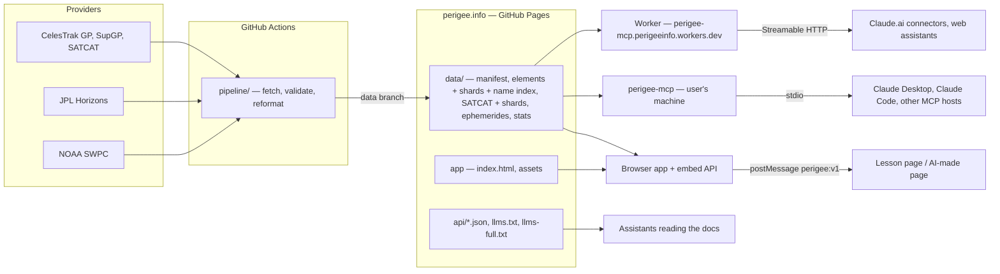
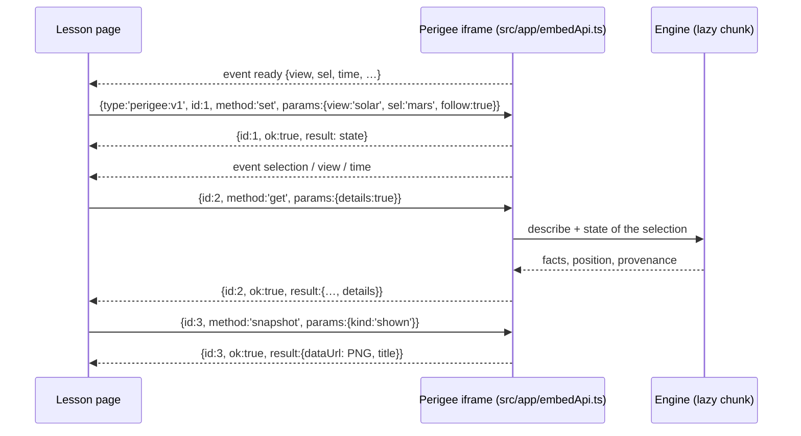
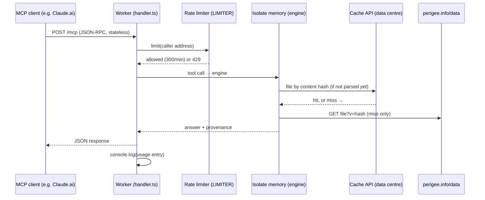

# Machine interface: architecture

How AI assistants, lesson pages and other programs use Perigee: the **embed API** (the live 3D view in an iframe),
the **local MCP server** (`npx perigee-mcp`) and the **hosted MCP endpoint** (Cloudflare Worker). All three rest on
one headless engine and on the data Perigee already publishes; none of them contacts CelesTrak or JPL Horizons.

Related documents: [`mcp/README.md`](../mcp/README.md) (users of the MCP server),
[`mcp-hosted.md`](mcp-hosted.md) (Cloudflare setup and CPU budget), [`mcp-publishing.md`](mcp-publishing.md)
(npm releases), [`public/llms.txt`](../public/llms.txt) and `https://perigee.info/api/interface.json` (machine-readable
description of the URL parameters, embed protocol, models and accuracy).

## Principles

- **Same code, same data.** Positions are computed by `src/astro` and `src/earth/sgp4.ts`, exactly as in the app,
  from the files the pipeline publishes on perigee.info (CLAUDE.md principle 1). Machine interfaces add no
  astrodynamics of their own beyond pass, sky and event searches built on the same libraries.
- **Provenance on every number.** Each computed answer says which model produced it, from which source, when the
  data were fetched, how old the elements are, whether the date is inside the ephemeris window, and a typical
  accuracy with its basis (`src/engine/provenance.ts`), plus the educational-use disclaimer.
- **Respect the providers.** Clients (browsers, MCP hosts, the Worker) only read perigee.info. The pipeline remains
  the only thing that talks to CelesTrak and Horizons, once per update cycle.
- **Nothing personal.** The embed shares only what it shows; the MCP servers need no account; the hosted endpoint
  logs no IP address and no place coordinates (see [Observability](#observability)).

## Overview



## The engine (`src/engine/`)

A DOM-free TypeScript module, bundled into the app (lazily, for the embed API's `details`), into the npm package and
into the Worker.

| Module                      | Role                                                                                                                                                                          |
| --------------------------- | ----------------------------------------------------------------------------------------------------------------------------------------------------------------------------- |
| `index.ts`                  | `createEngine()` → `Engine`: `find`, `describe`, `state`, `orbit`, `distance`, `series`, `passes`, `sky`, `events`, `stats`, `describeView`, `define`, `viewUrl`, `about`     |
| `data.ts`                   | `PublishedData`: reads `manifest.json` (10 min TTL), then files by content hash; whole files or one shard; name index; stats; injectable `fetch` and `ByteCache`              |
| `objects.ts`                | Catalogues (bundled, zod-validated), id resolution (`25544`, `mars`, `moon:titan`, `site:…`, `launch:…`, `star:…`), catalogue search, images, the app view of an object       |
| `state.ts`                  | Heliocentric state of any object at a date, with its provenance (SGP4 GP/SupGP, Hermite interpolation of Horizons, Kepler extrapolation, VSOP87, moon theories, sites, stars) |
| `provenance.ts`             | Model ids, data states, sources and the accuracy table                                                                                                                        |
| `ground.ts`, `regions.json` | WGS 84 geodetic ↔ Earth-fixed, planetocentric coordinates, country or sea below (Natural Earth 1:110m, public domain)                                                         |
| `orbitTools.ts`             | Ground point and sunlight of a state; mean SGP4 orbit or osculating elements                                                                                                  |
| `passes.ts`                 | Satellite passes over a place: geometric skip scan, bisection, golden section, naked-eye visibility                                                                           |
| `sky.ts`, `events.ts`       | The sky from a place; Moon phases, eclipses, seasons, planet events, mission milestones (astronomy-engine)                                                                    |
| `describeView.ts`           | A Perigee link in words (alternative text and description)                                                                                                                    |
| `apiDocs.ts`                | The static documents `api/*.json` and `llms-full.txt`, written at build time                                                                                                  |

### Data the engine reads

| File (under `data/`)                              | Written by         | Used for                                              |
| ------------------------------------------------- | ------------------ | ----------------------------------------------------- |
| `manifest.json`                                   | every pipeline run | hashes, fetch times, shard templates, stats entry     |
| `earth/gp-active/{shard}.json.gz` (256)           | GP run             | one satellite's elements (≈ 65 per shard)             |
| `earth/gp-names.txt.gz`                           | GP run             | name, NORAD and COSPAR search (text scan)             |
| `earth/satcat/{shard}.json.gz` (256)              | SATCAT run         | one satellite's owner, launch, type                   |
| `earth/stats.json.gz` (manifest `stats`)          | GP and SATCAT runs | counts by owner, operator, group, regime…             |
| `ephem/<mission>.bin`, `ephem/moons/<id>.bin`     | Horizons run       | probe and moon state vectors                          |
| `earth/gp-active.json.gz`, `earth/satcat.json.gz` | GP / SATCAT runs   | the app (whole files); engine fallback when no shards |

New manifest information always goes in **extra fields** of existing entries (or a new top-level field), never in a
new dataset key: older app versions validate `datasets` with a zod `partialRecord`, which rejects unknown keys.

## Embed API (in the app)

`?embed=1` shows the 3D view alone, with a corner link to the full app; `ui=panel,time` keeps the information panel
and/or the time bar; `follow=1` follows the selection. Any page can frame it.



- Methods: `ping`, `get` (`details: true` adds facts and position from the engine), `set` (view, sel, time, rate,
  frame, lang, follow; validated, an error names the parameter), `snapshot` (photo mode: as shown or objects only).
- Events to the parent: `ready`, `view`, `selection`, `time`. Replies go to the caller's origin.
- Selection in place: `View.selectId` (all four views); a different view is built with the new parameters.
- Nothing private crosses the API, so any origin may call it; the privacy pages say so.

## MCP tools

Defined once in `mcp/src/tools.ts` and served by both MCP servers.

| Tool                      | Answer                                                                     | Local limit  | Hosted limit |
| ------------------------- | -------------------------------------------------------------------------- | ------------ | ------------ |
| `perigee_find`            | ids by name (catalogues, then the satellite name index)                    | —            | —            |
| `perigee_object`          | facts, goals, status, website, sources, image (optionally inline)          | —            | —            |
| `perigee_state`           | position, velocity, distance, altitude, light time, sunlight, ground point | —            | —            |
| `perigee_orbit`           | mean SGP4 orbit (Earth satellites) or osculating elements                  | —            | —            |
| `perigee_passes`          | rise, culmination, set, naked-eye visibility over a place                  | 10 days      | 3 days       |
| `perigee_sky`             | Sun, twilights, Moon phase, planets, bright stars from a place             | —            | —            |
| `perigee_events`          | Moon phases, eclipses, seasons, planet events, mission milestones          | 366 days     | 31 days      |
| `perigee_stats`           | counts of active satellites                                                | —            | —            |
| `perigee_distance`        | distance and light time between two objects                                | —            | —            |
| `perigee_distance_series` | sampled distances, closest and farthest                                    | 1000 samples | 100 samples  |
| `perigee_view`            | app link, embed link, iframe, snapshot recipe                              | —            | —            |
| `perigee_describe_view`   | a link in words                                                            | —            | —            |
| `perigee_define`          | glossary (EN/FR)                                                           | —            | —            |
| `perigee_about`           | sources, fetch times, models and accuracy                                  | —            | —            |

The hosted limits keep each request within the free plan's 10 ms of CPU (see [`mcp-hosted.md`](mcp-hosted.md)).

## Local MCP server (`mcp/`)

- `mcp/src/cli.ts`: stdio transport, engine on `https://perigee.info/` (`PERIGEE_SITE` overrides), `User-Agent`
  `perigee-mcp/<version>`.
- `mcp/src/diskCache.ts`: files cached on disk by path and content hash (`%LOCALAPPDATA%\perigee-mcp`,
  `~/Library/Caches/perigee-mcp`, `~/.cache/perigee-mcp`; `PERIGEE_MCP_CACHE`), older versions of a file removed.
- Built by `npm run mcp:build` (Vite SSR bundle, minified: the catalogues and region outlines are inlined; npm
  dependencies external) into `mcp/dist/perigee-mcp.js`.
- Released by pushing a `mcp-v<version>` tag: `.github/workflows/mcp-release.yml` checks the version, runs the
  engine and MCP tests, builds and publishes through npm trusted publishing with provenance
  ([`mcp-publishing.md`](mcp-publishing.md)). The package has its own semver (1.1.1: 14 tools).

## Hosted endpoint (`workers/mcp/`)



- `src/index.ts`: one engine per isolate (parsed shards, index and tables stay in memory), `EdgeCache` on
  `caches.default` keyed by content hash (a week), the request counter for cold starts, the logger.
- `src/handler.ts`: `GET /` describes the server; `/mcp` runs a new MCP server per request with
  `enableJsonResponse` (no sessions); CORS open; bodies over 64 KB refused; the Worker's tool limits.
- `src/usageLog.ts`: the usage entry (below).
- `wrangler.jsonc`: `workers.dev` route, rate limit (300 requests a minute per address: Cloudflare counts loosely,
  60 refused clients after two or three requests), Workers Logs with invocation logs off.
- Deployed by `.github/workflows/mcp-worker.yml` on pushes touching the Worker, the MCP tools, the engine, the astro
  code or the catalogues (and by hand); without the Cloudflare secrets it only checks the bundle.

## Observability

Each `/mcp` request writes one JSON line to Workers Logs (kept 3 days on the free plan, 200,000 lines a day):

```json
{
  "evt": "mcp",
  "status": 200,
  "ms": 37,
  "isolateRequest": 1,
  "calls": [
    {
      "method": "tools/call",
      "tool": "perigee_passes",
      "objectId": "25544",
      "args": ["days", "id", "latitude", "longitude", "time_zone"],
      "ok": true
    }
  ],
  "country": "US",
  "colo": "IAD",
  "agent": "node"
}
```

- `calls`: the JSON-RPC messages; `initialize` carries the client's name and version (`client`), `tools/call` the
  tool, the object asked about (`id`, `from → to`, or a link's view and selection) and the argument names, then
  `ok` and the tool's error message. Coordinates, dates and free texts are never logged.
- `isolateRequest: 1` marks a cold start; `ms` is wall time (downloads included); `country`/`colo` are those of the
  connecting server (an AI service's, or the user's for a local client); `agent` is the User-Agent's first word.
- Cloudflare's invocation logs are off: they record request headers, IP addresses included.
- CPU time is not in these lines (a Worker cannot measure it); the dashboard has it per request percentile:
  Workers & Pages → perigee-mcp → **Metrics** (CPU time, errors such as 1102 "exceeded CPU", requests).

Reading the logs: Workers & Pages → perigee-mcp → **Observability** → Logs (or the Query Builder). Useful queries:

| Question             | Filter / group by                                           |
| -------------------- | ----------------------------------------------------------- |
| Which tools are used | group by `calls[0].tool`                                    |
| Which clients        | `calls[0].method = initialize`, group by `calls[0].client`  |
| Failing calls        | `calls[0].ok = false`, group by `calls[0].error`            |
| Rate-limited callers | `rateLimited = true`, group by `agent`, `country`           |
| Cold starts          | `isolateRequest = 1`                                        |
| Load tests           | `agent = perigee-loadtest` (exclude them from usage counts) |

## Load testing

`npm run mcp:load -- [options]` (`tools/loadtest/mcp-load.ts`) sends a weighted mix of tool calls (find, state,
object, orbit, distances, passes, sky, events, stats, view, describe, define) at a fixed rate and concurrency, and
prints latency percentiles, HTTP statuses, tool errors and CPU-limit errors (1102) per tool. Requests are tagged
`User-Agent: perigee-loadtest`.

- Local, no limit: `cd workers/mcp && npx wrangler dev`, then `npm run mcp:load -- --requests 300 --rate 20
--concurrency 8`. workerd does not enforce the CPU limit locally.
- Hosted: `npm run mcp:load -- --url https://perigee-mcp.perigeeinfo.workers.dev/mcp --remote` (at most 600
  requests at 4 a second, below the per-address limit; each counts in the 100,000 free requests a day). Watch the
  dashboard's CPU time and errors at the same time.

## Privacy

| Surface    | Receives                                    | Keeps                                                                                                    |
| ---------- | ------------------------------------------- | -------------------------------------------------------------------------------------------------------- |
| Embed      | messages from the framing page              | nothing (GoatCounter counts the page view, as for any visit)                                             |
| Local MCP  | nothing (it only downloads published files) | published files in the disk cache                                                                        |
| Hosted MCP | the questions the assistant's service sends | 3 days of usage lines (no IP, no coordinates or dates); the address is held a minute by the rate limiter |

The privacy pages (`public/privacy.html`, `public/confidentialite.html`) describe the same; update them with any
change to what the endpoint receives or keeps.

## Tests

| Test                                                | Covers                                                                                                                |
| --------------------------------------------------- | --------------------------------------------------------------------------------------------------------------------- |
| `tests/engine.test.ts`                              | distances vs astronomy-engine, ISS from fixture elements, provenance states, shards, view descriptions, local times   |
| `tests/ground.test.ts`, `tests/sky.test.ts`         | WGS 84, regions, passes vs satellite.js and a dense scan, the sky, eclipses 2020–2030 vs astronomy-engine, statistics |
| `tests/mcp.test.ts`                                 | every MCP tool through the SDK's in-memory transport                                                                  |
| `tests/mcpWorker.test.ts`                           | the hosted handler: routes, CORS, limits, rate limiting, the usage log (no coordinates or addresses)                  |
| `tests/embedApi.test.ts`, `tests/e2e/embed.spec.ts` | the postMessage protocol, an iframe driven by a page                                                                  |
| `tests/apiDocs.test.ts`                             | the static documents                                                                                                  |
| `tools/loadtest/mcp-load.ts`                        | behaviour under load (by hand)                                                                                        |

## Troubleshooting

| Symptom                                             | Cause and action                                                                                                                          |
| --------------------------------------------------- | ----------------------------------------------------------------------------------------------------------------------------------------- |
| HTTP 429 "Too many requests"                        | per-address limit; the client sends many requests at once. Raise `limit` in `wrangler.jsonc` if real clients hit it.                      |
| Error 1102 / 503 from Cloudflare                    | a request exceeded the free plan's CPU. Check the tool in the logs and the Worker's limits; the paid plan removes the constraint.         |
| `perigee_stats`: "not published yet"                | no GP or SATCAT run since the stats code was deployed; it appears after the next run.                                                     |
| Old satellite positions (`dataFetchedAt` hours old) | the GP pipeline failed or GitHub skipped its schedule; see Actions → Data — CelesTrak GP. Never retry in a loop (CelesTrak policy).       |
| `perigee_find` misses a well-known name             | CelesTrak names it differently (e.g. Tiangong is "CSS (TIANHE)"); add the satellite to `catalog/earth-science.json` with its known names. |
| npm publish 403 "OIDC permission denied"            | the trusted publisher lacks the publish permission ([`mcp-publishing.md`](mcp-publishing.md)).                                            |
